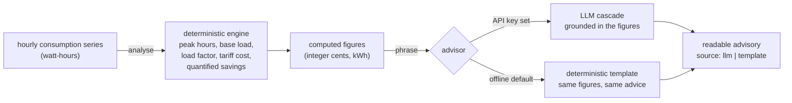

# EnerGPT

An energy-sector copilot that reads an hourly electricity-consumption series for
a home or small building and produces a readable, **grounded** energy-saving
advisory. A deterministic engine does all the arithmetic — peak hours, base load,
load factor, time-of-use cost, and quantified savings — and a provider-agnostic
LLM only *phrases* those numbers. With no API key it runs fully offline: a
deterministic template renders the same substantive advice.

[](.github/workflows/ci.yml)
[](pyproject.toml)
[](LICENSE)

---

## Why it matters

Most "AI energy coach" demos hand the meter data straight to a language model and
ask it for savings tips. The model then invents plausible-sounding numbers —
"you could save about 15%" — that are not tied to the data and cannot be checked.
EnerGPT inverts that. The numbers are computed, exactly and reproducibly, and the
LLM is confined to wording them:

- **Grounded.** Every figure in the advisory is produced by the analysis engine
  from the consumption series. The advisor is handed those figures and may use
  only them.
- **Honest about the split.** The substance (what to do and how much it saves) is
  deterministic; the LLM contributes fluency, not facts. The result records
  whether the LLM or the offline template wrote it.
- **Offline by default.** No network and no API key are required. Set a provider
  key and the LLM phrases the identical computed advice.

## How it works



1. **Generate (`generate.py`).** Synthesise a deterministic hourly series for a
   sample home/building: a base load, a daily curve with an evening peak, a
   weekend bump, and a little noise — reproducible from a seed.
2. **Analyse (`analysis.py`).** The engine. Compute the peak-usage hours, the
   overnight base load, the load factor, the cost under a configurable
   time-of-use tariff (peak/off-peak), and quantified savings (shifting part of
   the peak load to off-peak; trimming standby/base-load draw). Money is integer
   **cents**; energy is integer **watt-hours**.
3. **Advise (`advisor.py`).** Turn the computed figures into prose — via the LLM
   cascade when a provider is configured, or a deterministic template offline.
   The advisor may use only the figures the analysis produced.
4. **Tips (`knowledge.py`).** A small energy-efficiency tip base with TF-IDF
   retrieval answers a free-text question ("how do I cut standby power?") with a
   grounded, cited tip.

## The deterministic-substance / LLM-phrasing split (the honest part)

This is the design decision that makes the advice trustworthy, so it is worth
stating plainly.

**The LLM never computes a number.** It is not asked "how much could this home
save?" — that question is answered by `analysis.py` in integer cents, from the
series. The LLM (or the offline template) is asked only to *write the figures up*
as readable prose. The advisor builds a fixed set of formatted **facts** from the
analysis and renders only those; the LLM prompt is built from the same facts and
instructed to ground strictly in them and invent nothing.

Concretely, the cost of some energy is pure integer arithmetic, rounded to the
cent once per tariff bucket:

```
cost_cents(energy_wh, rate_cents_per_kwh) = (energy_wh * rate + 500) // 1000
```

A shift saving is the rate difference applied to the shifted energy; a base-load
saving is the avoided draw priced hour-by-hour at each hour's own rate. All of it
is recomputable by hand (see `tests/test_analysis.py`, which does exactly that).

Because of this split:

- **Offline and online give the same substance.** Without a key, a template
  phrases the figures; with a key, the LLM phrases the *same* figures. The advice
  (what to do, how much it saves) does not change — only the wording does.
- **The advisory cannot invent numbers.** A test extracts every money, energy,
  and percentage figure from the template's output and asserts each one was
  computed by the analysis. The LLM is given the same constraint in its prompt,
  and the structured analysis is always returned alongside the prose so a reader
  can check it.
- **It is honest about which path ran.** `source` is `"llm"` or `"template"`.

## Quick start

```bash
python -m venv .venv && source .venv/bin/activate
pip install -e ".[dev]"

# Analyse a sample home and print the advisory (works offline, no API key):
python -m energpt.cli demo

# Answer one energy-efficiency question from the tip base:
python -m energpt.cli ask "how do I cut standby power?"

# Run the HTTP API:
uvicorn energpt.main:app --reload
```

The demo analyses a two-week sample home and prints, among other things:

```
   total consumption 124.48 kWh
   base load (night) 135 W
   load factor       0.3855  (1.0 = perfectly flat)
   usage peaks at    19:00, 18:00, 20:00 (up to 871 W)
   total bill        $22.54  ($1.61/day, ~$48.30/month)
   - Shift peak-hour load to off-peak   save $2.28  (12.67 kWh)
   - Cut always-on standby (base load)  save $1.66  (11.09 kWh)
   => total $3.94 over the period, ~$8.40/month
```

Example API calls:

```bash
# Analyse a named sample, with an optional free-text question
curl -s -X POST localhost:8000/analyze -H 'content-type: application/json' \
  -d '{"sample": "home", "question": "how do I cut standby power?"}'

# Analyse a raw hourly series (watt-hours), starting at midnight
curl -s -X POST localhost:8000/analyze -H 'content-type: application/json' \
  -d '{"series": [120, 110, 105, 300, 900, 850, 400]}'

# Answer a tip question
curl -s -X POST localhost:8000/ask -H 'content-type: application/json' \
  -d '{"question": "when should I run the washing machine?"}'

curl -s localhost:8000/samples
```

## Using a real LLM provider

The advisor is provider-agnostic. Set any of `ANTHROPIC_API_KEY`,
`OPENAI_API_KEY`, `GEMINI_API_KEY`, or `DEEPSEEK_API_KEY` (or run a local Ollama)
and the cascade in `EP_LLM_SPEC` is tried in order, each provider skipped if it
fails, falling back to the deterministic template if all fail. With **no** key
set, the advisor stays fully offline and makes no network calls at all.

## Configuration

Settings load from environment variables with the `EP_` prefix (see
`.env.example`):

| Variable                   | Default                                   | Meaning                                              |
| -------------------------- | ----------------------------------------- | ---------------------------------------------------- |
| `EP_PEAK_START_HOUR`       | `17`                                      | First hour of the peak tariff window                 |
| `EP_PEAK_END_HOUR`         | `21`                                      | End of the peak window (exclusive)                   |
| `EP_PEAK_RATE_CENTS`       | `30`                                      | Peak tariff rate, cents per kWh                      |
| `EP_OFFPEAK_RATE_CENTS`    | `12`                                      | Off-peak tariff rate, cents per kWh                  |
| `EP_OVERNIGHT_START_HOUR`  | `0`                                       | Start of the overnight window for base-load readout  |
| `EP_OVERNIGHT_END_HOUR`    | `6`                                       | End of the overnight window (exclusive)              |
| `EP_SHIFTABLE_PCT`         | `30`                                      | Percent of peak energy assumed shiftable to off-peak |
| `EP_STANDBY_REDUCTION_PCT` | `25`                                      | Percent of base load assumed avoidable standby       |
| `EP_TOP_USAGE_HOURS`       | `3`                                       | How many hours-of-day to report as the usage peak    |
| `EP_LLM_SPEC`              | `anthropic,openai,gemini,deepseek,ollama` | LLM provider cascade, tried in order                 |
| `EP_LLM_MAX_TOKENS`        | `500`                                     | Max tokens per LLM call                              |

Provider API keys live in their own environment variables and are never
hard-coded.

## Testing

```bash
ruff check energpt tests
pytest --cov=energpt --cov-report=term-missing --cov-fail-under=80
```

The suite covers the analysis arithmetic (a by-hand probe checks peak detection,
tariff cost and the savings math to the exact cent), the advisor on both paths
(`FakeLLM` phrases, `FailingLLM` falls back to the template), the guarantee that
the template invents no numbers, TF-IDF tip retrieval, the HTTP API, and the CLI.
Tests use `FakeLLM`/`FailingLLM`, so nothing touches a real network.

## Documentation

- `docs/architecture.md` — components, data flow, and the design rationale.
- `docs/adr/` — the main design decisions and their trade-offs.
- `docs/estudio/` — a study guide in Spanish, for learning the project in depth.

## A note on scope

EnerGPT is a reference implementation, not a metering or billing product. The
consumption series is synthetic, the tariff model is a simple two-rate
time-of-use scheme, and the savings percentages are configurable assumptions, not
a measured audit of any specific home. A production system would ingest real
smart-meter data, model a full tariff (standing charges, demand charges, feed-in),
and base the shiftable/standby fractions on appliance-level disaggregation. What
it demonstrates is the architecture: compute the substance deterministically, let
the LLM phrase it, and never let the model invent a number.

## License

MIT. See [LICENSE](LICENSE).
