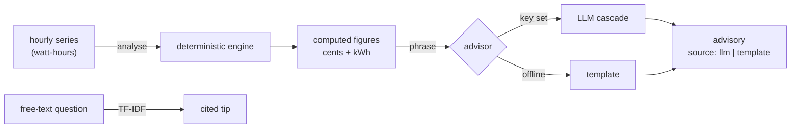

# Architecture

EnerGPT has a deterministic analysis core and a thin phrasing layer on top. The
core computes everything a reader will act on; the phrasing layer (an LLM, or an
offline template) only turns those computed figures into prose. The LLM is never
trusted to produce a number.

## Components

| Component    | File                    | Responsibility                                               |
| ------------ | ----------------------- | ------------------------------------------------------------ |
| Generator    | `energpt/generate.py`   | Synthetic, deterministic hourly consumption series (Wh)      |
| Analysis     | `energpt/analysis.py`   | The engine: peaks, base load, load factor, tariff cost, savings |
| Advisor      | `energpt/advisor.py`    | Phrase the computed figures (LLM cascade or offline template) |
| Knowledge    | `energpt/knowledge.py`  | Energy-efficiency tip base + TF-IDF retrieval                |
| LLM interface| `energpt/llm/`          | Provider-agnostic client with a fallback cascade             |
| Service      | `energpt/service.py`    | Orchestration: series → analyse → advise (+ tip answer)      |
| HTTP API     | `energpt/main.py`       | REST surface over the service                                |
| CLI          | `energpt/cli.py`        | End-to-end demo and a single-question ask                    |
| Config       | `energpt/config.py`     | Tariff, savings assumptions and LLM spec (`EP_` env vars)    |

## Data flow

## The central idea: compute the substance, phrase it with the LLM

The characteristic failure of an "AI energy advisor" is a confident number with
no basis: a model asked for savings will happily produce "around 15%" untethered
to the data. EnerGPT removes the model from the arithmetic entirely.

- **Analysis computes the substance.** Peak-usage hours, base load, load factor,
  the cost split under the tariff, and each quantified saving are computed in
  `analysis.py`, deterministically, from the series.
- **The advisor only phrases it.** It builds a fixed dict of formatted *facts*
  from the analysis and renders only those. The LLM prompt is built from the same
  facts and told to ground strictly in them. Offline, a template renders the same
  facts. Either way, no number enters that the analysis did not compute.

This is why the offline and online outputs carry the same advice: the only
difference is wording, recorded in the `source` field.

## Why money is integer cents

Floating-point money accumulates rounding error (`0.1 + 0.2 != 0.3` in binary).
Every monetary amount is an `int` number of cents. Tariff rates are cents per
kWh, and a cost is `(energy_wh * rate + 500) // 1000` — round-half-up, pure
integer arithmetic, applied once per aggregated tariff bucket so rounding cannot
compound. Formatting to a currency string happens only at the presentation edge.

## How the savings are computed

Two opportunities, both grounded in the computed energy split:

- **Load shift.** Moving `EP_SHIFTABLE_PCT` of the peak-window energy to off-peak
  saves the rate difference on the shifted energy: `cost(shift, peak_rate) −
  cost(shift, offpeak_rate)`. The total energy used does not change — it just
  moves to cheaper hours.
- **Standby / base load.** The base load runs every hour, so trimming
  `EP_STANDBY_REDUCTION_PCT` of it is priced hour-by-hour at each hour's own rate:
  the avoided peak-hour draw at the peak rate, the off-peak draw at the off-peak
  rate.

## Every phrasing stage is pluggable, with a fallback

The LLM is the provider-agnostic `LLMClient` with a cascade over Anthropic,
OpenAI, Gemini, DeepSeek and Ollama. When no provider key is in the environment
the service builds no client at all and the advisor renders the template, so the
default path makes no network calls. When keys are present the cascade is tried
in order and the advisor still falls back to the template if every provider
fails.

## Extension points

- **Consumption source.** `generate.py` is synthetic; a real smart-meter feed
  drops in behind the same list-of-watt-hours interface.
- **Tariff and assumptions.** The peak window, the two rates, and the
  shiftable/standby percentages are all configuration.
- **Providers.** A new LLM provider is one adapter plus one registry line.
- **Tip base.** `TIPS` is plain data; swap in a domain corpus behind the same
  `retrieve` interface.
